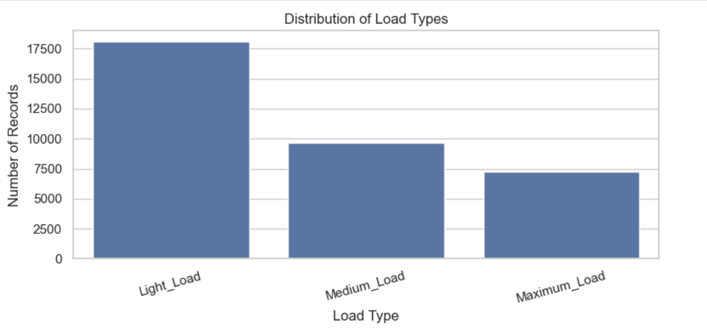
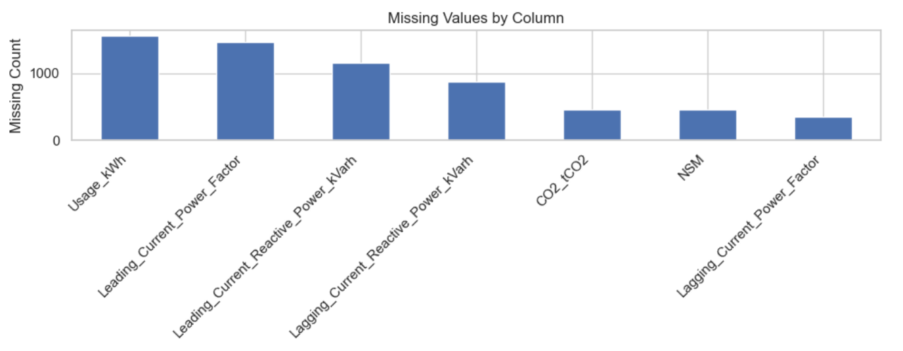
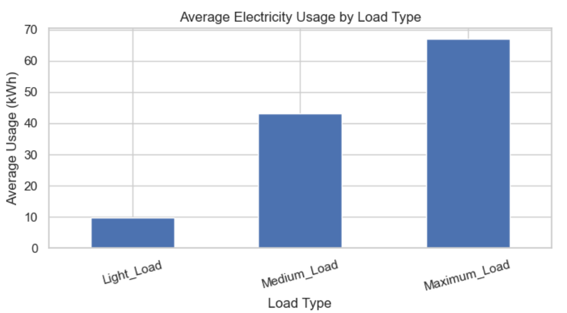
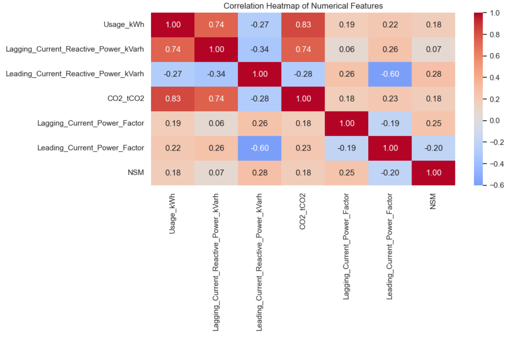
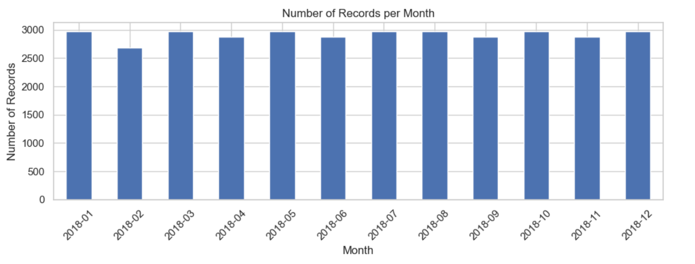
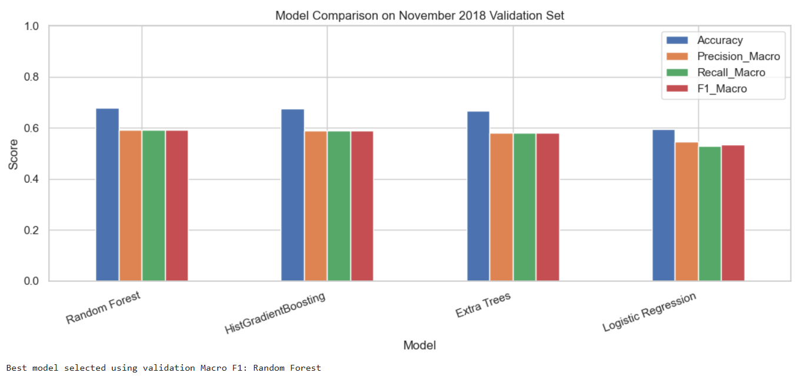
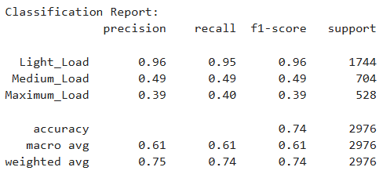
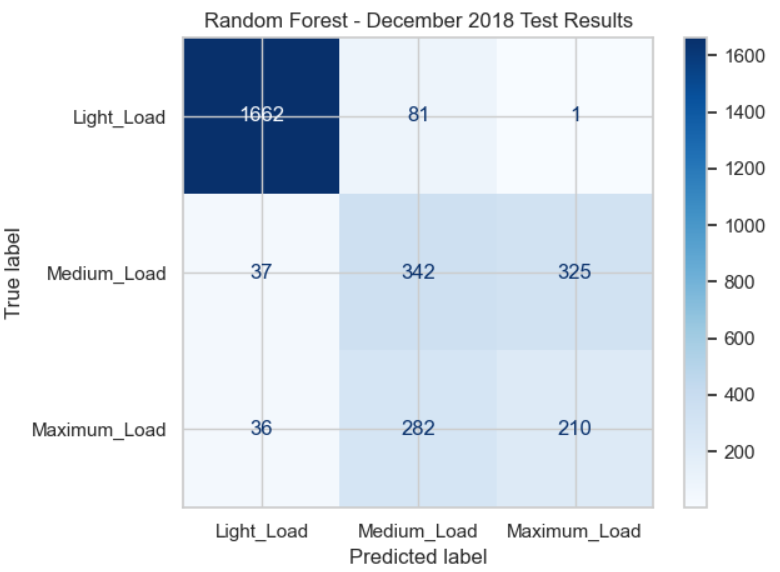

# Electricity Load Type Classification using Machine Learning

## 1. Project Overview

This project uses machine learning to classify electricity consumption patterns into three categories: **Light Load, Medium Load, and Maximum Load**. The goal is to build and evaluate classification models using historical electricity consumption data and time-based features.

The project covers data preprocessing, exploratory data analysis (EDA), feature engineering, model comparison, and final evaluation on a held-out test dataset.

## 2. Objectives

- Clean and preprocess the electricity consumption dataset.
- Explore load-type distributions and relationships between numerical features.
- Extract useful time-based features from timestamps.
- Train and compare multiple machine learning classification algorithms.
- Evaluate the selected model using accuracy, precision, recall, and F1-score.

## 3. Dataset Description

The dataset contains timestamped electricity consumption records and electrical measurements.

**Target variable:** `Load_Type`

| Load Type | Description |
|---|---|
| `Light_Load` | Low electricity load |
| `Medium_Load` | Moderate electricity load |
| `Maximum_Load` | High electricity load |

### Main Features

| Feature | Description |
|---|---|
| `Date_Time` | Date and time of each observation |
| `Usage_kWh` | Electricity consumption in kWh |
| `Lagging_Current_Reactive_Power_kVarh` | Lagging reactive power |
| `Leading_Current_Reactive_Power_kVarh` | Leading reactive power |
| `CO2_tCO2` | CO₂ emissions measurement |
| `Lagging_Current_Power_Factor` | Lagging current power factor |
| `Leading_Current_Power_Factor` | Leading current power factor |
| `NSM` | Number of seconds from midnight |
| `Load_Type` | Target classification label |

*Note: The exact units and definitions should be confirmed against the original dataset documentation.*

## 4. Technologies Used

- Python
- Jupyter Notebook
- Pandas and NumPy
- Matplotlib and Seaborn
- Scikit-learn

## 5. Project Workflow

### Step 1: Data Cleaning

- Standardized column names.
- Converted timestamps to datetime format.
- Converted numerical features to numeric data types.
- Checked missing values and duplicate timestamps.
- Removed duplicate timestamps while retaining the first record.
- Handled missing numerical values using median imputation within model pipelines.

### Step 2: Exploratory Data Analysis (EDA)

EDA was performed to understand the dataset and identify patterns.

**Load Type Distribution**




**Missing Values**




**Average Electricity Usage by Load Type**




**Correlation Heatmap**




**Monthly Record Distribution**




## 6. Feature Engineering

The following features were extracted from `Date_Time`:

- `Hour`
- `DayOfWeek`
- `Month`
- `Hour_sin` and `Hour_cos`
- `Month_sin` and `Month_cos`

Sine and cosine transformations were used to represent the cyclical nature of hours and months. The original timestamp was excluded from the model inputs.

## 7. Training, Validation, and Test Strategy

The dataset was divided chronologically to avoid randomly mixing earlier and later observations.

| Dataset | Period | Records |
|---|---|---:|
| Training | January–October 2018 | 29,184 |
| Validation | November 2018 | 2,880 |
| Testing | December 2018 | 2,976 |
| **Total** | **January–December 2018** | **35,040** |

The validation set was used to compare models and select the best-performing classifier. The December test set was reserved for final evaluation.

## 8. Models Evaluated

Four classification algorithms were compared:

1. Logistic Regression
2. Random Forest Classifier
3. Extra Trees Classifier
4. HistGradientBoosting Classifier

The models were evaluated using:

- **Accuracy:** Overall proportion of correct predictions.
- **Macro Precision:** Average precision across all classes, treating each class equally.
- **Macro Recall:** Average recall across all classes, treating each class equally.
- **Macro F1-score:** Average F1-score across all classes, treating each class equally.

Macro F1-score was used as the main model-selection metric to consider performance across all three load types.

## 9. Model Comparison Results

The following table contains the observed validation results.

| Model | Accuracy | Macro Precision | Macro Recall | Macro F1-score |
|---|---:|---:|---:|---:|
| Random Forest | 0.6778 | 0.5911 | 0.5917 | **0.5913** |
| HistGradientBoosting | 0.6760 | 0.5890 | 0.5899 | 0.5893 |
| Extra Trees | 0.6660 | 0.5816 | 0.5821 | 0.5818 |
| Logistic Regression | 0.5962 | 0.5463 | 0.5297 | 0.5354 |

Random Forest achieved the highest validation Macro F1-score and was selected as the final model.




## 10. Final Test Results

The selected Random Forest model was evaluated on the held-out December 2018 test set.

| Metric | Test Score |
|---|---:|
| Accuracy | **74.43%** |
| Macro Precision | 61.18% |
| Macro Recall | 61.24% |
| Macro F1-score | 61.21% |

### Class-wise Performance

| Load Type | Precision | Recall | F1-score | Support |
|---|---:|---:|---:|---:|
| Light_Load | 0.96 | 0.95 | 0.96 | 1,744 |
| Medium_Load | 0.49 | 0.49 | 0.49 | 704 |
| Maximum_Load | 0.39 | 0.40 | 0.39 | 528 |




### Confusion Matrix

The confusion matrix shows how many observations were correctly classified and which load types were confused with one another.




## 11. Key Findings

- Random Forest performed best among the four evaluated models according to validation Macro F1-score.
- The final model achieved 74.43% accuracy on the December 2018 test set.
- Light_Load was classified most accurately, with an F1-score of 0.96.
- Medium_Load and Maximum_Load were more difficult to distinguish, with F1-scores of 0.49 and 0.39, respectively.
- The difference between accuracy and Macro F1-score indicates that overall accuracy alone does not fully represent performance across all load categories.

## 12. Limitations and Future Improvements

Potential improvements include:

- Hyperparameter tuning using the training and validation periods.
- Additional time-based and lag features, designed without using future information.
- Further investigation of confusion between Medium_Load and Maximum_Load.
- Evaluation of additional classification algorithms.
- Testing on a later time period to assess performance under changing consumption patterns.

Any further model tuning should use training and validation data, not the December test results.

## 13. How to Run the Project

1. Clone or download this repository.
2. Install the required Python libraries:

   ```bash
   pip install pandas numpy matplotlib seaborn scikit-learn jupyter
   ```

3. Place the dataset CSV in the project folder.
4. Open the Jupyter Notebook:

   ```bash
   jupyter notebook
   ```

5. Open `Electricity_Load_Type_Classification.ipynb`.
6. Update the CSV filename in the data-loading cell.
7. Run all cells from top to bottom.

## 14. Conclusion

This project demonstrates a complete machine learning workflow for electricity load-type classification, from data preprocessing and exploratory analysis to model comparison and final testing.

Random Forest achieved 74.43% test accuracy and a 61.21% Macro F1-score. Although performance was strong for Light_Load, further improvements are needed to classify Medium_Load and Maximum_Load reliably.

The project highlights the importance of chronological data splitting and class-wise evaluation when building classification models for time-dependent data.

---

**Project Type:** Machine Learning / Classification

**Language:** Python

**Notebook:** `Electricity_Load_Type_Classification.ipynb`